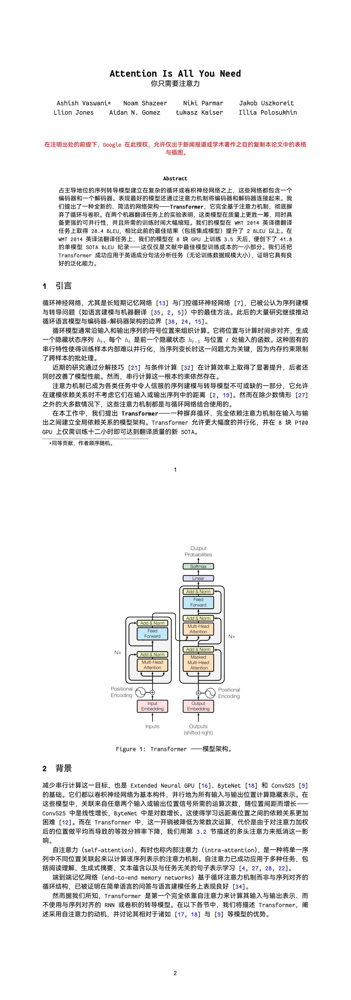
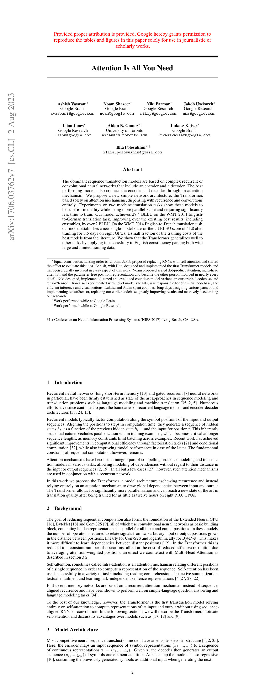
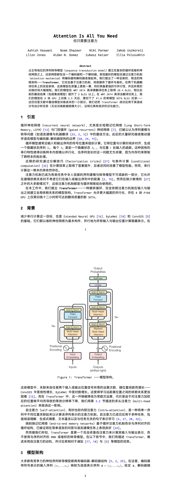

# TransPaper 📄➡️🇨🇳

> 把 arXiv 论文 / 本地 PDF 翻译成排版精良、便于阅读的**简体中文 PDF**。
> 一个基于 **Claude Code Skills** 的论文翻译工作区。

<table>
  <tr>
    <td width="8%" align="center"></td>
    <td width="42%" align="center"><b>英文原版</b></td>
    <td width="8%" align="center"></td>
    <td width="42%" align="center"><b>简体中文译本</b></td>
  </tr>
  <!-- trans-arxiv-paper -->
  <tr>
    <td align="center" rowspan="2"><b>trans-<br>arxiv-<br>paper</b></td>
    <td align="center"></td>
    <td align="center"><b>➡</b></td>
    <td align="center"></td>
  </tr>
  <tr>
    <td align="center"><sub>assets/example.pdf（英文原版）</sub></td>
    <td></td>
    <td align="center"><sub>assets/example_arxiv.pdf（中译本）</sub></td>
  </tr>
  <!-- trans-pdf -->
  <tr>
    <td align="center" rowspan="2"><b>trans-<br>pdf</b></td>
    <td align="center"></td>
    <td align="center"><b>➡</b></td>
    <td align="center"></td>
  </tr>
  <tr>
    <td align="center"><sub>assets/example.pdf（英文原版）</sub></td>
    <td></td>
    <td align="center"><sub>assets/example_pdf.pdf（中译本）</sub></td>
  </tr>
</table>

> 📌 **上图效果展示（原版 ➡ 译本，各取第 1–2 页）**：
> - **trans-arxiv-paper** —— 从 arXiv TeX 源码翻译《Attention Is All You Need》；
> - **trans-pdf** —— 从本地英文 PDF 翻译同一篇《Attention Is All You Need》。

---

## 为什么做这个项目 🤔

直接把 PDF 丢给翻译器（OCR / 整页翻译）往往会得到**版式错乱、公式崩坏、术语前后不一致**的结果。这个项目反过来操作：**从论文的 LaTeX 源码出发**，保留原文的数学公式、参考文献、图表引用与标签，再把正文译为中文，最后用 XeLaTeX / Tectonic 重新编译成 PDF。

这样得到的产物：
- 公式、表格、引用、图编号**原汁原味**；
- 术语全书统一，专业术语首次出现时括注英文；
- 输出的是结构化的 `.tex` 工程，**可 diff、可局部重译、可校对**；
- 配合两款内置字体，中文与西文/数学混排观感统一。

> Skill 本质上是“**提示词与工作流的沉淀**”，而非黑盒魔法 —— 它把领域流程、约束与工具调用方式结构化下来。安装到支持 Agent Skills 的环境（Claude Code、Codex、Cursor 等）即可直接驱动 Agent 执行。

---

## 包含两个 Skill 🧩

本仓库是一个 Claude Code Skills 工作区，提供两个互补的翻译技能：

| Skill | 触发方式 | 输入 | 工作流要点 |
|-------|----------|------|-----------|
| **`trans-arxiv-paper`** | 给出 arXiv 链接/ID | `https://arxiv.org/abs/1706.03762` | 下载 `/src/` 的 TeX 源码 → 翻译 → 编译 |
| **`trans-pdf`** | 给出本地 PDF 路径 | `/path/to/paper.pdf` | 提取图像（区分位图/矢量图并校正方向）→ 处理表格/算法/图引用 → 翻译 → 编译 |

### `trans-arxiv-paper` 流程
1. 规范化 URL → `https://arxiv.org/src/{id}`
2. 下载源码包到 `/tmp/papers/{id}.tar.gz`（已存在则跳过）
3. 解压、定位入口文件（如 `main.tex` / `ms.tex`）
4. 把 LaTeX 正文译为简体中文，保留公式、引用、标签、图路径与常见学术术语
5. 在 `\begin{document}` 前注入 `xeCJK + fontspec` 及字体配置
6. 用 **Tectonic** 编译产出 PDF，输出到 `./docs/{id}-CN/`

### `trans-pdf` 流程
1. 为该 PDF 创建多文件 XeLaTeX 工程，输出到 `./docs/{name}-CN/`（`main.tex` + `preamble.tex` + 每章一个 `.tex` + `figures/`）
2. 提取图像：位图用 `pdfimages`，矢量图用 PyMuPDF 按“图标题区域”渲染；用页面变换矩阵判定旋转/镜像并校正
3. 处理图像引用与算法：每个 `\includegraphics` 显式指定 `width`（≤ 0.85\textwidth）；伪代码用 `algorithm` 环境而非 `figure`
4. 处理表格：含示意图的复杂表格整块渲染为图像替换
5. 正文译为简体中文（术语统一、公式逐条加 `\label`）
6. 用 **xelatex** 编译两遍
7. 交付前自检并修复（多子图重复、图缺失/截断、算法冒占图号、超宽图、未定义引用……）

---

## 使用方式 💻

### 安装

本仓库本身就是一个 Claude Code Skills 工作区，无需额外“安装脚本”——只要在 Claude Code 中打开本目录，两个 Skill 即被自动识别：

```bash
git clone https://github.com/l0190/PaperTranslator.git
cd TransPaper
claude   # 启动 Claude Code
```

> 也可将 `.claude/skills/` 下的目录复制到你自己的项目 `.claude/skills/` 中单独使用。

### 调用

直接用自然语言说出意图即可，Agent 会自动按对应 Skill 执行：

- **arXiv 论文**
  > “把 `https://arxiv.org/abs/1706.03762` 翻译成中文 PDF”
  > “帮我翻译 1706.03762”
  > “把 *Attention Is All You Need* 和 2501.12948 都翻译一下”

- **本地 PDF**
  > “把 `Clippings/PushAndPull.pdf` 翻译成中文”
  > “翻译这份 PDF：`/home/lin/papers/some-paper.pdf`”

> **核心要求**：提供能**唯一确定论文**的信息（arXiv ID / 链接 / 标题，或本地 PDF 路径）并表达翻译意图即可。

---

## 与“直接翻译 PDF”的对比 📊

| 维度 | 直接整页翻译 PDF | 本项目（基于 LaTeX 源码 / 结构化重建） |
|------|------------------|------------------------------------------|
| 版式与公式 | OCR / 分栏易错乱，公式常崩 | 保留源码中的数学与引用，编译为正常 PDF |
| 翻译粒度 | 按页切分，与章节结构脱节 | 按结构翻译：标题、摘要、正文…… |
| 上下文与质量 | 分块输入，上下文窄，术语不一致 | 大上下文，术语与论述更统一 |
| 可校对性 | 难以按原结构修订 | 输出 `.tex`，可 diff、可局部重译 |
| 图表处理 | 直接随页翻译，常错位 | 矢量/位图分别提取、校正方向、显式控宽 |

> **限制**：`trans-arxiv-paper` 仅适用于 arXiv 上**提供了 LaTeX 源码**的论文；纯 PDF 投稿请改用 `trans-pdf`。

---

## 字体 🅰

为保证中英文混排与公式观感统一，两个 Skill 共用一套内置字体（位于 `.claude/skills/fonts/`）：

- **西文 / 等宽**：[`CascadiaMono`](https://github.com/microsoft/cascadia-code)（微软开源编程字体，与 Cascadia Code 同仓库同许可，含 Light / Regular / SemiBold / Bold 等字重，正文与代码统一观感）
- **中文 / 无衬线**：[`HarmonyOSSans`](https://developer.huawei.com/consumer/cn/design/) SC（含 Bold 等字重）

字体随仓库分发，无需额外下载；输出工程会把 `fonts/` 一并复制到目标目录，保证可移植、可离线编译。

### 字体许可声明

本项目随仓库再分发以下第三方字体，版权归各自权利人所有，感谢开源与开放授权：

| 字体 | 版权所有 | 许可证 |
|------|----------|--------|
| **Cascadia Mono** | © Microsoft Corporation | [SIL Open Font License 1.1](https://openfontlicense.org/open-font-license-official-home/) |
| **HarmonyOS Sans** | © Huawei Device Co., Ltd. | [HarmonyOS Sans Fonts License Agreement](.claude/skills/fonts/HarmonyOSSans/LICENSE-update.txt)（随字体目录附于 `LICENSE-update.txt`） |

- **Cascadia Mono** 依据 SIL Open Font License 1.1 授权使用与再分发。Cascadia Mono 与 Cascadia Code 同属微软 [cascadia-code](https://github.com/microsoft/cascadia-code) 字体家族，[许可证全文](https://github.com/microsoft/cascadia-code/blob/main/LICENSE)随仓库分发。字体文件未作任何修改。
- **HarmonyOS Sans** 依据《HarmonyOS Sans Fonts License Agreement》随本软件捆绑再分发。依该协议第 2 条要求特此显著声明：**本软件使用了 Huawei Device Co., Ltd. 提供的 HarmonyOS Sans 字体**。该字体未经修改、未单独出售；协议全文及版权声明随字体目录一并保留（`.claude/skills/fonts/HarmonyOSSans/LICENSE-update.txt`），且该字体不得脱离本软件单独分发或出售。

---

## 仓库结构 📂

```
TransPaper/
├── .claude/
│   └── skills/
│       ├── trans-arxiv-paper/        # arXiv 论文翻译 Skill
│       │   ├── SKILL.md              # Skill 主描述（Agent 实际读取的核心内容）
│       │   └── references/
│       ├── trans-pdf/                # 本地 PDF 翻译 Skill
│       │   └── SKILL.md
│       └── fonts/                    # 内置字体（CascadiaMono + HarmonyOSSans，含许可文件）
├── assets/                           # README 效果截图（demo 对比图 + 示例 PDF）
├── .gitignore                        # 忽略 docs/ tmp/ Clippings/ CLAUDE.md 等
└── README.md
```

> 翻译产物与中间文件默认不入库（见 `.gitignore`）：
> - `docs/` —— 翻译输出目录（`./docs/{name}-CN/`，含 `main.tex`、各章节、`figures/`、`fonts/` 副本与编译出的 `main.pdf`）；
> - `Clippings/` —— 待翻译的英文 PDF 原文；
> - `tmp/`、`CLAUDE.md` —— 临时文件 / 工程级指引（仅本地）。

---

## 环境要求 🛠️

- **Claude Code**（或任何支持 Agent Skills 的 CLI / IDE）
- Python 3.12（项目使用名为 `claude` 的 mamba/conda 环境，见 `CLAUDE.md`）
- **Tectonic**（`trans-arxiv-paper` 编译器）：`conda install -c conda-forge tectonic`
- **xelatex**（`trans-pdf` 编译器）：TeX Live / MiKTeX，或同样用 Tectonic
- 图像处理：`pdfimages`（poppler）、PyMuPDF

---

## 致谢 🙏

- 字体：[Cascadia Mono](https://github.com/microsoft/cascadia-code)（© Microsoft Corporation，SIL OFL 1.1）、[HarmonyOS Sans](https://developer.huawei.com/consumer/cn/design/)（© Huawei Device Co., Ltd.，许可声明见「字体」章节）
- 翻译工作流思路参考：[Leey21/arxiv-translator](https://github.com/Leey21/arxiv-translator)
- 示例论文：《Attention Is All You Need》(Vaswani et al., 2017, arXiv:1706.03762)

---

## License 📝

MIT License
